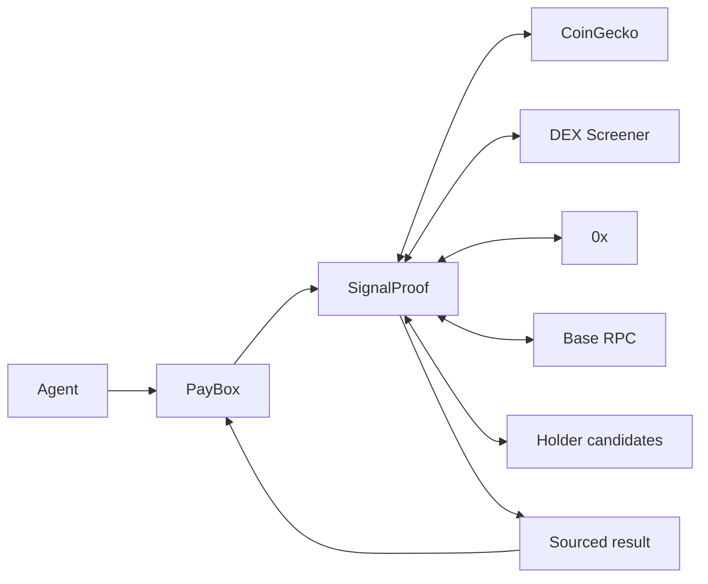
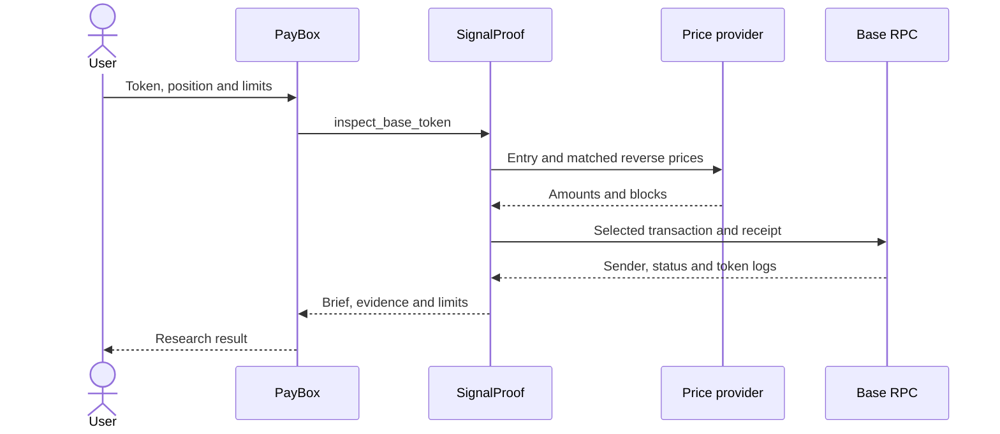
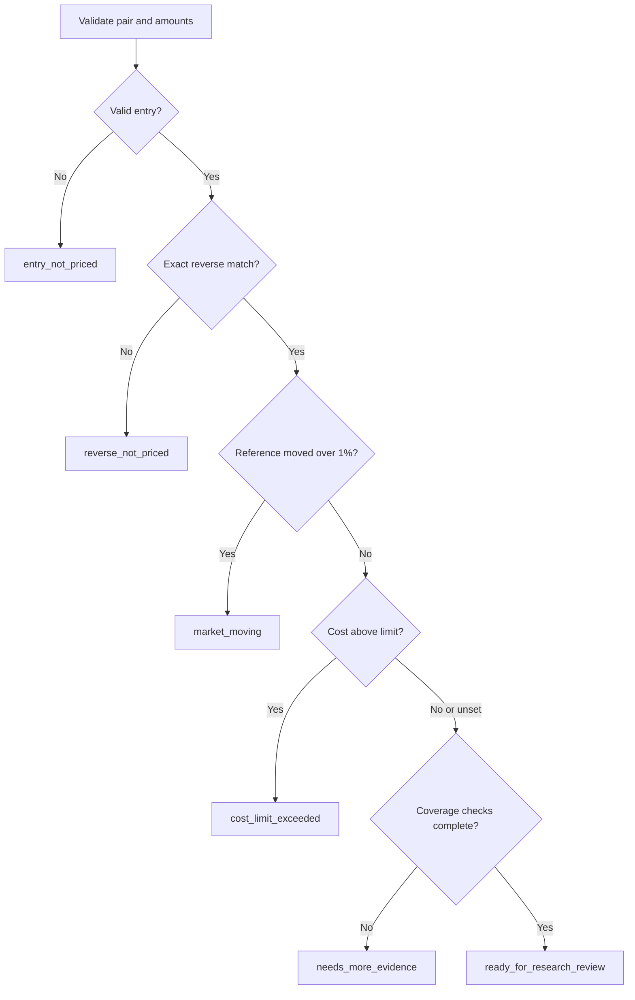

<!-- README documents the checked 0.6.0 candidate. Do not turn snapshots into live claims. -->
<p align="center"></p>

# SignalProof

Evidence-based Base token research inside PayBox, with position-specific pricing and explicit verification limits.


## Overview

A quoted token price does not tell you whether an entry and reverse route match, what network costs add, or how much of a holder claim was checked. SignalProof gathers those observations and explains the evidence, contradictions and missing checks in a sourced research brief.

It is for people researching Base tokens and for agents that need structured evidence before suggesting a next research step. It is in **private testing**. It does not certify token safety, guarantee an exit, confirm an invoice has been paid, or execute a trade.

This README documents **0.6.0**, matching `plugin/package.json`, the MCP server version in `plugin/src/plugin.ts`, and the local project status. Starter version 1.0.2 identifies the PayBox starter tooling, not the SignalProof release.

## How it works

PayBox runs the uploaded MCP bundle and mediates allowed outbound requests. SignalProof combines pool observations, size-specific entry/reverse prices and selected onchain checks. Cost and holder analysis are separate tools; a successful research brief does not imply either has run.



[Architecture SVG](docs/diagrams/architecture.svg). The holder-candidate provider is the fifth host added in 0.6.0; the original four remain the core pricing/verification hosts.

The sequence below is a **transaction-sample verification within research**, not merchant payment or invoice verification. Price matching and receipt checks support different claims.



[Sequence SVG](docs/diagrams/verification-sequence.svg).

## Features

| Tool | Inputs | Output and scope |
| --- | --- | --- |
| `inspect_base_token` | Exact Base token address; optional `positionUsdc`, `maxRoundTripDifferencePct`, `maxTradeAgeMinutes` | Structured report and Markdown brief: pool observations, source timestamps, price ladder, contradictions, selected receipt checks and next checks. |
| `assess_base_execution_cost` | Token and public `taker` address; optional position, `maxTotalCostPct`, `slippageBpsPerLeg` | Unsigned quote scenario with swap/approval network estimates, L1/operator fee bounds and ETH-to-USDC conversion. Cost completeness and wallet readiness are separate. |
| `inspect_base_holder_concentration` | Exact Base token address | Up to 80 candidate balances, decimals and total supply checked at one fixed block; block hash rechecked; candidate coverage and candidate-scoped ranking. |
| `verify_base_sample` | Token, transaction hash; optional expected sender and pool | Independent Base chain, transaction/receipt hash, block hash, sender, success and target-token Transfer checks. Pool-address log activity is reported separately. |
| `propose_research_purchase` | `{"asset":"ethereum"}` | Optional unsigned x402 proposal for broad Ethereum context, capped at 0.10 USDC. It neither pays locally nor resolves arbitrary token-specific gaps. |

Positions are decimal strings from **1 to 10,000 USDC**, with at most six decimal places. The default is `"500"`. Token research preserves the 25/100/500-USDC ladder and adds a different requested position. Latest-trade age defaults to 30 minutes; accepted range is 1–1440 minutes. Cost limits accept 0–100 percent. Cost-tool slippage defaults to 25 basis points per leg, with an accepted range of 0–500.

The brief's decision order matters: missing entry or reverse evidence takes priority over a cost-limit conclusion.



[Decision SVG](docs/diagrams/price-pair-decision.svg). A pair match requires the expected token direction, valid positive bounded amounts, available liquidity and the reverse sell amount equal to the entry buy amount. The brief's price-only difference excludes network costs. None of these states authorizes execution.

## Requirements and supported hosts

Use **Node.js 24** and **pnpm 11.11.0**. Starter metadata records Node **24.21.0**. Conformance requires Node 24 on **Linux or macOS**; on Windows, run the build/check commands inside **WSL2**. The plugin is TypeScript, using the MCP server SDK, Zod, esbuild and Node's test runner. Dependencies are pinned in `plugin/package.json` and `plugin/pnpm-lock.yaml`.

| Exact hostname | Purpose | Credentials |
| --- | --- | --- |
| `api.coingecko.com` | Base pool discovery, metadata and capped trade observations | CoinGecko Demo key only |
| `api.dexscreener.com` | Independent pool metadata and liquidity comparison | Neither project key |
| `api.0x.org` | Size-specific prices and unsigned wallet-specific quotes | 0x key only; `0x-version: v2` is a non-secret API version header |
| `mainnet.base.org` | Base transaction/receipt checks, fee estimates and fixed-block holder balances | Neither project key |
| `pro-api.coinmarketcap.com` | Public holder-candidate discovery for 0.6.0 | Neither project key |

The optional purchase proposal names an `api.messari.io` Ethereum-context resource. It is handled separately by PayBox's transaction/payment flow; it is not a sixth automatic fetch performed by the read-only research tools. Do not add hosts or send credentials to that endpoint merely to run the core demo.

## Installation on PayBox

1. Clone the [repository](https://github.com/abdraufdele/signalproof):

   ```sh
   git clone https://github.com/abdraufdele/signalproof.git
   cd signalproof
   ```
2. From the repository root, install and check the plugin:

   ```sh
   cd plugin
   pnpm install --frozen-lockfile
   pnpm test
   ```

3. A passing build produces `plugin/dist/plugin.mjs` relative to the repository root. It is generated locally and excluded from Git. Upload **only this bundle**, not a ZIP, source folder or `.env`, at [PayBox Developers](https://developer.paybox.sh/dashboard).
4. Set the project name/description, the five exact hosts above and the two issuer-scoped brokered header credentials below. Save the runtime configuration.
5. Run the hosted read-only examples below and inspect their structured results. A successful local conformance check alone does not establish hosted API access.
6. Review the candidate and PayBox terms before submitting it for review. According to the saved [developer guide](plugin/requirements-reference.md), submitting for review makes the pending version available privately in the owner's account. Submission is distinct from uploading for testing.
7. In the same PayBox account, open **Plugins → Unofficial plugins → SignalProof**. Review the exact version, hosts and credential bindings, then accept and enable that version.
8. Connect an agent using the official `https://api.paybox.sh/mcp` endpoint with OAuth. Share only credentials actually needed and choose an appropriate expiry. The observed UI offers transaction approval modes rather than a mode labelled read-only; the research tools themselves perform read-only operations.
9. Through the connected agent, call `discover_plugins`, then `get_plugin`, then `use_plugin` using the returned installation ID and current schemas. Do not substitute a portal project ID or assume the ID equals `signalproof`.

SignalProof 0.6.0 has been submitted for review and exercised through its owner-private installed agent. Public distribution requires PayBox's manual approval of each code version. This repository does not claim public marketplace approval.

## Configuration

Configure credentials in PayBox's header broker, not in plugin source, sample arguments or the uploaded bundle.

| Credential name | Placeholder value | Allowed issuer | Header |
| --- | --- | --- | --- |
| `COINGECKO_DEMO_API_KEY` | `YOUR_COINGECKO_DEMO_API_KEY` | `api.coingecko.com` only | `x-cg-demo-api-key` |
| `ZEROX_API_KEY` | `YOUR_ZEROX_API_KEY` | `api.0x.org` only | `0x-api-key` |

Neither key goes to DEX Screener, Base RPC or the holder-candidate provider. The broker adds a key only for its configured issuer; this is not permission to send it through another provider or redirect.

The root `.env.example` documents optional local-development values. If using it, copy it to a local `.env` and replace placeholders privately. The four research tools do not read that file or request a wallet private key. Standalone execution outside PayBox requires an equivalent controlled fetch/header broker; `pnpm dev` does not automatically load and attach API keys.

## Usage

In the developer portal's tool tester, select `inspect_base_token` and provide:

```json
{
  "token": "0x4200000000000000000000000000000000000006",
  "positionUsdc": "250.123456",
  "maxRoundTripDifferencePct": 2,
  "maxTradeAgeMinutes": 30
}
```

This is the **real historical 0.4.1 hosted case**, captured on 17 October 2026 at 06:18 UTC. It is retained as a sanitized compatibility example for the current interface, not a current quote or a newly repeated 0.6.0 hosted test.

| Observation | Saved result |
| --- | --- |
| Exact USDC atomic amount | `250123456` |
| Ladder plus chosen position | 25, 100, 500 and 250.123456 USDC |
| Entry/reverse pairs matched | 4 of 4 |
| Price-pair errors | None |
| Chosen-position indicative return | 249.355405 USDC before gas |
| Chosen-position difference | Approximately 0.307069% before gas |
| Brief state | `ready_for_research_review` |
| Separate transaction verification | `sample_verified`; no swap-direction/amount verification |

Actual response fields include the following excerpt. Fresh requests can return different values or an incomplete state.

```json
{
  "positionUsdc": "250.123456",
  "positionAtomic": "250123456",
  "evidenceStatus": "indicative_entry_and_exit_available",
  "brief": {
    "state": "ready_for_research_review",
    "returnedUsdcBeforeGas": 249.355405,
    "roundTripDifferencePct": 0.3070687620756424,
    "withinUserCostLimit": true
  },
  "noPaymentOrTradeExecuted": true
}
```

For the full-cost scenario, select `assess_base_execution_cost`, provide the same token, your **public** Base `taker` address and `positionUsdc`, and optionally set `maxTotalCostPct` and `slippageBpsPerLeg`. Inspect `status`, `gaps`, `estimatedTotalCostPct`, `withinCostLimit`, `walletReady` and `walletIssues`. Do not treat `executionVerified: false` as verified execution.

For holders, call `inspect_base_holder_concentration` with the token. Read `blockNumber`, `blockHashRechecked`, `candidateSource`, `candidateSnapshotAgeMinutes`, `verifiedBalanceCount`, `coveredSupplyPct` and `gaps` together.

## Demo

A connected PayBox agent completed the three research tools in the saved 17 October 2026 workflow. A separate ChatGPT connection was subsequently verified, with only SignalProof Test shared in "Complete transactions in PayBox" mode. Its recorded expiry was 18 October 2026; confirm the connection is still active before rehearsing.

For a ChatGPT demonstration, select PayBox in a new chat and ask it to discover the installed SignalProof tools. Research Base WETH (contract 0x4200000000000000000000000000000000000006) for a 500-USDC position, a 2% round-trip difference limit, a 2% total-cost limit and a maximum latest-trade age of 30 minutes. Request token research, a cost scenario using the granted wallet's public address with 25 bps slippage per leg, and synchronized holder analysis. Explicitly prohibit trading, signing, transaction approvals and paid research.

Show the actual tool calls and distinguish acceptable estimated costs from wallet readiness. Explain holder-candidate coverage and unresolved evidence. Dated results are not current quotes. The saved ChatGPT prompt was prepared but not confirmed sent in the available checkpoint.

**TODO:** add the owner-verified recorded walkthrough/video and published demo URL. No such file or URL was found in the project during this catch-up. Private raw evidence and wallet-specific records are excluded from this repository.

## Testing and verification

Run the offline source regressions from `plugin/`:

```sh
node --import tsx --test tests/research.test.mjs tests/brief.test.mjs tests/quality.test.mjs tests/pacing.test.mjs tests/cost.test.mjs tests/holders.test.mjs
```

Run the evidence and study-scoring regressions from the repository root:

```sh
node --test scripts/metrics.test.mjs scripts/evidence.test.mjs scripts/study-score.test.mjs
```

The saved 0.6.0 release record reports **49 source regressions and 18 evidence/study regressions: 67 passing**. Coverage includes exact six-decimal positions, preserving the ladder, matched reverse quantities, wrong pair/amount rejection, receipt/sender mismatches, duplicate/invalid observations, freshness and clock rules, bounded deadlines, partial provider failures, cost/fee completeness and fixed-block holder checks. Study-scoring tests validate software logic; they are not genuine participant feedback.

From `plugin/`, `pnpm test` also runs type checking, two builds with matching hashes, and starter conformance. Its manifest sample is `propose_research_purchase`: conformance checks the **unsigned proposal format**, not payment or research delivery. It does not replace the read-only regressions above. The current manifest, SDK dependencies and starter pins are preserved.

To reproduce hosted read-only verification:

1. Run the custom-position example above through the hosted tester or installed agent.
2. Check all four `quotes[].reversePriceMatched` values, pair identities, exact quantities, provider errors, timestamps and coverage. Passing historical numbers are not assertions for live prices.
3. Take one `transactionHash` and its `reportedSender` from that **new** result's `pools[].sampleTransactions`, and the corresponding pool identifier.
4. Select `verify_base_sample`. Pass `token`, that `transactionHash`, `expectedSender` and `expectedPool` using the current schema. No account-specific hash or address is bundled in this example.
5. Inspect `chainVerified`, `hashesMatch`, `blockHashesMatch`, `senderMatches`, `transactionSucceeded`, `targetTokenTransferObserved`, `poolActivityState` and `errors`. A `sample_verified` result still has `swapDirectionAndAmountVerified: false`.
6. Run the cost and holder tools separately. Preserve raw results privately, with local receipt times and the deployed version under test. Never invoke the paid proposal to poll or complete a research-only check.

The three saved **0.6.0 installed-agent** research calls succeeded on 17 October 2026. The 500-USDC WETH cost scenario returned approximately 0.8031774% against a 2% limit, while `walletReady` was false. The holder call checked 80 candidates covering approximately 74.8104% of supply at one block. These are dated observations, not current market facts. Raw evidence and account-specific inputs stay outside this repository; [validation scope](docs/validation.md) explains the remaining caveats.

## Security notes

- Four research tools are read-only. RPC calls and unsigned quote requests do not sign, change allowances or submit transactions. Cost-tool native-balance overrides are read-only estimation inputs.
- The optional purchase tool is explicitly not read-only: it returns an unsigned, capped proposal. PayBox handles actual wallet selection, policy, approval, signing and payment. No payment has been demonstrated by the saved research workflow.
- Never share a seed phrase, private key or PayBox authentication token. A public taker address is sufficient for cost analysis.
- Broker keys only to the exact issuer host. Do not put credentials in URL query strings, screenshots, examples, fixtures or the bundle.
- Network destinations, body limits, deadlines and errors are bounded. Missing evidence stays missing; errors do not establish a lack of liquidity or malicious token behavior.
- The repository allowlist excludes `.env`, raw outputs, browser/session data, local runtimes, builds and account-specific delivery files. The checked test fixtures contain public provider/onchain replay data; they are historical test inputs, not user feedback or live evidence.
- A private GitHub repository is not a safe place to commit secrets. If a secret is ever committed, rotate it and address history; deleting the working file is insufficient.

## Troubleshooting

| Symptom | Check or action |
| --- | --- |
| 401/403 provider response | Check the broker's exact issuer, header name, key validity and account plan; never route a key through a different issuer. |
| 429 or missing provider data | Respect provider limits and check the recorded error. A missing response is not a zero-liquidity finding. |
| `invalid_price_fields` or unmatched reverse | Inspect token direction, exact integer quantities, liquidity flag and response bounds. Keep the exit unresolved. |
| `operation_budget_exhausted`, timeout or `response_too_large` | Inspect the partial result and provider health. Do not remove bounds to manufacture a passing result. |
| Holder provider outage | WETH may use an explicitly dated candidate snapshot, at most 24 hours old. Balances and supply are still fetched live. Other gaps remain explicit. |
| Cost estimate available but wallet not ready | Read `walletIssues` and simulation/balance/allowance diagnostics. Funding or approvals are separate user decisions, unnecessary for the research demo. |
| Private plugin absent | Confirm submission-for-review, owner account, exact accepted version and enabled state. Upload alone is not installation. |
| Agent cannot find SignalProof | Confirm OAuth uses the same account, then discover current IDs/schemas. A portal project ID can differ from an installation ID. A fresh chat resolved a stale MCP registry in the saved demo; this is not a universal fix. |
| Runtime or lockfile mismatch | Use Node 24 and pnpm 11.11.0; the tested runtime is 24.21.0. Run starter conformance on Linux/macOS, or WSL2 on Windows. Retain the lockfile and pinned dependencies. |

## Limitations and roadmap

- Research covers Base only. Prices and fee scenarios are sequential and can change; a current entry/reverse scenario is not a future exit guarantee or funded execution simulation.
- Receipt checks verify selected transaction/sender/token activity. They do not decode swap direction/amounts or establish payment purpose, invoice settlement, economic ownership or the accuracy of every provider claim. A 32-byte pool ID is not verified as an emitting pool address.
- Observed sender addresses are not independent people. Capped observations are not complete trading history; pool creation time is not token deployment time.
- Holder calculations cover provider candidates rebalanced at one block. Complete holder discovery, global ranking and beneficial ownership are unverified. Provider labels and sampled bytecode checks do not establish owners.
- Optional paid context is broad Ethereum research; token-specific relevance and a completed paid-response workflow have not been demonstrated.
- **Open evidence checks:** installed-agent timestamps lagged local receipt by about 90 seconds. Delivery-time freshness remains unverified. The MCP responses did not attest the deployed version/hash; installation-to-portal mapping needs confirmation.
- **Remaining delivery work:** genuine user feedback, a reviewed recorded demo and the required X video publication. No participant usefulness claim is established yet.
- **TODO:** add a public contact route.

## License and contact

**License: [MIT](LICENSE).** SignalProof source code is available under the MIT License. The included Inter font notice applies to the wordmark's font source. Third-party starter/dependency license terms still apply.

**Contact: TODO — owner-approved contact or repository issue URL.** Do not use project API keys, wallet addresses or private account details as contact information.
